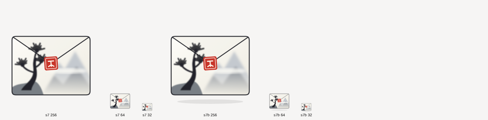

# The Tegami Mail icon

This page describes the new application icon: what it shows, why, how it is
built, and what is left to do to ship it. The artwork is in
[`data/repo/design/icon/`](../data/repo/design/icon/); nothing in the build
uses it yet.

## The idea

*Tegami* (手紙) is the Japanese for "letter". The icon is a paper envelope
drawn the way a sumi-e (ink wash) painting is: a flap traced in black ink,
soft grey washes, a lot of white, and a single touch of colour, the red seal
(hanko). The picture on the envelope shows misty mountains and a pine on a
rock.

- It must read as a mail icon at 32 px: a rectangle, a V flap, a red seal.
- Everything inside is original artwork, drawn for this project. It is
  inspired by the ink-wash style, not copied from any print or logo.
- The pine, the mountains and the seal are the only "painted" parts. The
  rest is flat paper.

## Files

| File | What it is |
|------|------------|
| `tegami-mail.svg` | The proposed icon: thin ink line, very light drop shadow. 128×128 viewBox. |
| `tegami-mail-no-shadow.svg` | Same icon without the shadow. Use it if the shadow is drawn elsewhere. |
| `tegami-mail-{512,256,128,64,48,32}.png` | Reference exports of `tegami-mail.svg`, made with Chromium. For comparison only, do not ship them. |
| `preview-sheet.png` | The icon at 256, 64 and 32 px, both variants side by side. |

## Construction (back to front)

All coordinates are in the 128×128 viewBox. The envelope body is the rounded
rectangle x 12–116, y 26–104, radius 5.

1. Soft ground shadow: an ellipse under the envelope (`tegami-mail.svg` only).
2. Paper: a diagonal gradient, `#fdfcf8` to `#eeebe1`.
3. Mountains: two blurred washes (`#c4c9cf`, `#8d939b`) behind a mask that
   fades them into the paper towards the bottom, plus a pale blurred band
   of mist across them.
4. Flap: a translucent paper veil over the top triangle and a thin ink line
   from the top corners to the centre point (64, 62).
5. Rock and pine: a grey wash for the rock, a tapered ink trunk, three
   branches and three fans of needle strokes (short round-capped lines
   radiating from one point). The pine is drawn after the flap so it
   crosses the fold.
6. Outline: the rounded rectangle, stroke 1.25, `#23242a`.
7. Seal: a red rounded square (`#c8362b`, 18×18, turned −4°) with a thin cream
   inner frame and an abstract cream mark. The mark is deliberately not a
   real character.

Palette: ink `#23242a`, paper `#fdfcf8` / `#eeebe1`, washes `#c4c9cf` and
`#8d939b`, rock `#70767d`, seal `#c8362b` with `#fbeee4`.

## What was tried and dropped

An earlier crane-and-envelope and several coloured, folded-paper envelopes
(indigo, cream, red) were drawn and set aside: the owner wanted an ink-wash
look. A folded top-right corner was tried and removed (too busy). Keep the
icon simple: do not add detail that disappears at 32 px.

## Status (2026-11-07)

- Checked with librsvg 2.61 (`rsvg-convert`, the renderer
  `tools/gen-app-icons.py` uses): the clip path, the mask, the gradients and
  both blurs draw as intended at 512, 256, 64 and 32 px. The only visible
  difference with the Chromium exports is the pine, a little crisper:
  librsvg applies the 0.45 blur at its true scale. Nothing needed
  simplifying.
- `data/icons/src/default.svg` is now `tegami-mail.svg`, and
  `default.Devel.svg` adds GNOME's development stripe (yellow and dark
  diagonal bands) across the foot of the envelope. `hicolor/` is
  regenerated; the app embeds the 512 px PNG, so the build uses the new icon
  with no other change. `data/repo/logo.png` is no longer tracked (nothing
  links it since the Hylki files were removed); the script still writes it.
- The symbolic icon already is the envelope outline with the V flap.

## To do before it ships

The SVG was checked in Chromium only. GNOME renders icons with librsvg, so
first make sure it draws the same there.

1. Check the rendering with `tools/gen-app-icons.py` (it uses librsvg). The
   file uses `clipPath`, `mask`, linear gradients and `feGaussianBlur`.
   If any of them renders wrongly, replace it with something librsvg draws
   correctly (for the mist: a gradient instead of a blur) and keep the look.
2. Done: see Status above.
3. Done: the gallery of alternative icons is removed (owner's decision,
   2026-11-07), with its Settings row, its wizard step and the restart it
   offered; at start an earlier pick is cleared from the launcher.
4. Draw the symbolic (16 px, single colour) icon:
   `data/icons/hicolor/symbolic/apps/io.github.DocteurScience.TegamiMail-symbolic.svg`.
   Designer's brief: the envelope outline with the V flap, nothing else.
5. Done (2026-11-11): no Hylki artwork is left; the About window shows the
   icon above the name. Was: update the About dialog, the AppStream file
   (`data/io.github.DocteurScience.TegamiMail.metainfo.xml`) and the README
   artwork if they show the old icon, and credit the old Hylki artwork in
   [CREDITS.md](CREDITS.md) if any of it stays.
6. Capture the icon in a GNOME shell (app grid, dock at 48 px, About
   dialog) in light and dark, and compare with `preview-sheet.png`.

## Licence

The artwork is under the project's licence, AGPL-3.0-or-later (owner's
decision, 2026-11-07).
